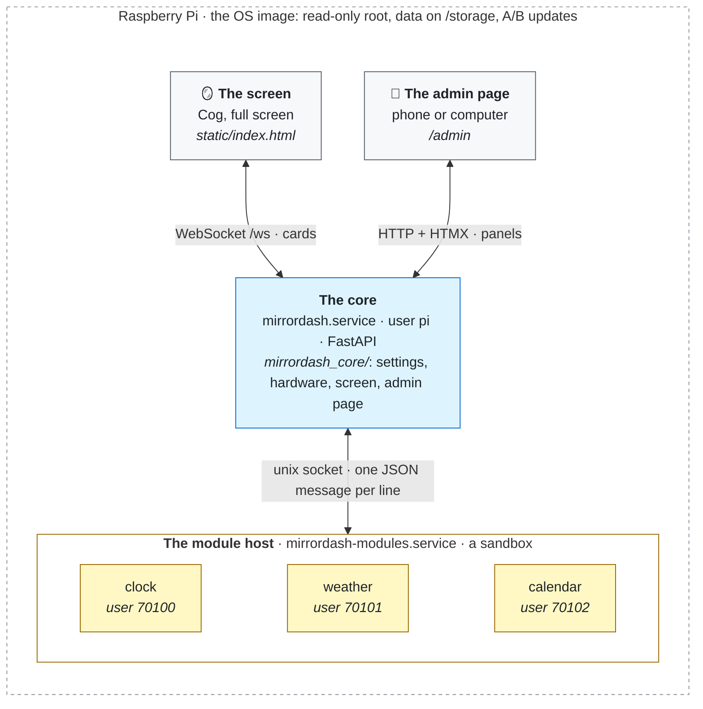
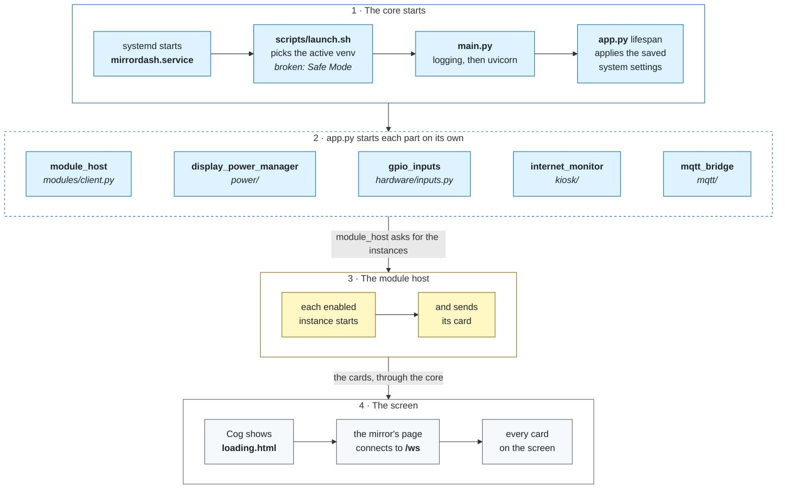
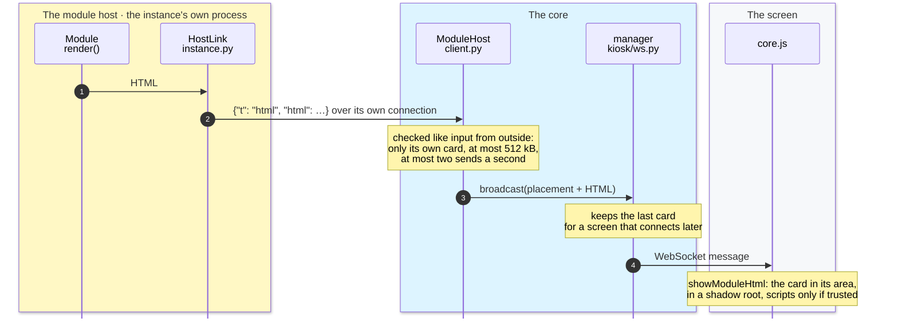
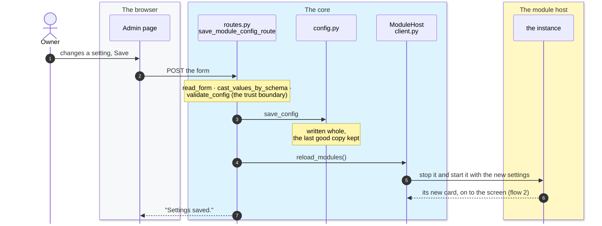

# How MirrorDash Works

A map for someone new to the code: the parts, how they talk, and what happens in the three moments that matter most. It says *how* things fit together; [ARCHITECTURE.md](ARCHITECTURE.md) says *why* they were built that way (the numbers in brackets, #41, point there). Start with [CONTRIBUTING.md](CONTRIBUTING.md) to get it running.

## The big picture

- **The core** is one Python program (FastAPI). It serves the mirror's screen and the admin page, keeps the settings in `config.json`, runs the hardware (screen power, GPIO, Wi-Fi) and never runs a module's code.
- **The module host** runs the modules: the clock, the weather, a calendar. Each module comes from its own repository (made with the [SDK](https://github.com/Menturan/mirrordash-sdk)) and is installed as a Python package. On a mirror each instance runs sandboxed, as a user of its own, so a broken or hostile module can't reach the core's files, the passwords or the other modules (#41).
- **The screen** is a web page (`static/index.html`, `static/js/kiosk/core.js`) in Cog, a full-screen browser. It draws what the core sends over one WebSocket and does nothing else (#2).
- **The admin page** (`templates/admin.html`, `static/admin/`) is where the owner changes things. Each tab is a panel the server renders as HTML; HTMX swaps it in.
- **The OS image** (`scripts/`) is Raspberry Pi OS with a read-only root (#5), the owner's data on `/storage` (#12), and updates that install to a second copy of the system and switch over only when it boots (#31).

## Words used in the code

| Word | Means |
|---|---|
| **module** | A Python package that shows something on the mirror (`mirrordash-weather`). Found through its entry point in the `mirrordash.modules` group (#3). |
| **instance** | One use of a module, with its own settings: two clocks are two instances of one module. Its id is its key in `config["modules"]`. |
| **card** | The HTML one instance shows on the screen. The core decides where it goes (its *placement*: area, carousel, size). |
| **the core** | `mirrordash_core`, the server. "Core's side" means code that runs in that process. |
| **module host** | The service the modules run in (`features/modules/host.py`), apart from the core. |
| **forkserver** | The module host's first process: it makes every other process as the right user (`forkserver.py`). |
| **control process** | The module host's process that answers the core: users, installs, self-checks (`host.py` `Control`). |
| **module site** | Where modules are installed: a folder per module and a folder of links to them, in two copies (site_a, site_b) like the core's venvs (`site_folders.py`). |
| **venv A/B** | The core's own Python environments: an update builds the other one and switches only if it starts (#16). |
| **overlay** | A device-tree overlay: how a button or sensor on the GPIO pins is told to the Linux kernel, in `config.txt` (#19). |
| **slice** | A feature folder under `features/`: its routes, logic and templates together (#27). |
| **rootfs** | `scripts/image/rootfs/`: every file the OS image installs as it is, at its path on the mirror. |

## Flow 1: the mirror starts

1. **systemd** starts `mirrordash.service`, which runs `scripts/launch.sh`. It picks the active venv (the link `/storage/mirrordash/venv`), falls back to the image's own copy if that is broken (safe mode, #17) and starts `python -m mirrordash_core.main`.
2. **`main.py`** sets up logging (`~/.mirrordash/logs/`) and starts uvicorn with the app from **`app.py`**.
3. **`app.py`'s `lifespan`** applies the saved system settings (`system_settings.py`: rotation, brightness, time zone, SSH) and starts the long-running parts, each on its own so one failure doesn't stop the rest:
   - `module_host.start_modules()` (`features/modules/client.py`) connects to the module host and asks it to start every enabled instance,
   - `display_power_manager` (`features/power/`) turns the screen on and off on schedule,
   - `gpio_inputs` (`features/hardware/inputs.py`) listens for buttons and motion sensors,
   - `internet_monitor` (`features/kiosk/`) notices when the internet goes away,
   - `mqtt_bridge` (`features/mqtt/`) connects to Home Assistant, if set up (#42).
4. **Cog** (`cog-kiosk.service`) shows `loading.html` until the server answers, then the mirror's page. `core.js` opens the WebSocket `/ws`, and the core sends it every card it already has (`features/kiosk/ws.py` keeps the last one of each, #9).

## Flow 2: a module's card reaches the screen

1. **In the module's own process** (`features/modules/instance.py`), the module returns HTML from `render()` (or calls its `broadcast_func`). `loader.py` started it and gave it its helpers: `self.fetch` (`module_fetch.py`), `self.render_template`, `self.translate` and more.
2. **`HostLink.html`** sends `{"t": "html", "html": ...}` over the instance's connection. The protocol is listed at the top of `host.py`.
3. **`client.py` `ModuleHost._handle`** gets it in the core. Everything an instance sends is checked like input from outside: its connection is who it is, so it can only fill its own card; a card over 512 kB isn't shown; at most two sends a second reach the screen (#30).
4. **`ws.py` `manager.broadcast`** adds the placement and sends it to every open screen, and keeps it for a screen that connects later.
5. **`core.js` `showModuleHtml`** puts the card in its area, inside a shadow root so the module's CSS can't touch the rest of the page, and runs its scripts only if the module is trusted (#21, #41).

The other way, the core sends an instance: the screen going on or off (its fetches sleep meanwhile, #29), hardware events (`event_bus.py`), calls to its own routes (`api_proxy.py`, #40) and Home Assistant commands (`on_control`).

## Flow 3: the owner saves a module's settings

1. **The admin page** shows the settings form, built from the module's JSON schema (`config_schema.json`) by `forms.py`, without running the module.
2. **Save** posts it to `features/modules/routes.py` `save_module_config_route`, which:
   - reads the form (`forms.read_form`) and types each value by the schema (`cast_values_by_schema`),
   - checks the whole config (`features/settings/schema.py` `validate_config`, the trust boundary),
   - saves it (`config.py` `save_config`: written whole, the last good copy kept).
3. **`module_host.reload_modules()`** tells the screen to reload and runs `_sync`: an instance whose settings changed is stopped and started again with the new ones; the others keep running and send their cards again.
4. **The answer** is a small event for the page (`admin.notify`): "Settings saved." The settings drawer stays open.

The system settings (Hardware, Power, Developer) take the same road through `system_settings.py`, and are applied straight away instead of restarting modules.

## The module system's files

The biggest part of the core, in `features/modules/`:

| File | Runs in | What it is for |
|---|---|---|
| `client.py` | core | `ModuleHost`: the core's side; starts and stops instances, checks what they send |
| `api_proxy.py` | core | `/api/modules/<instance>/...` forwarded to a module's own routes |
| `lan.py` | core | which home-network addresses each instance may reach |
| `routes.py`, `service.py` | core | the admin page's Modules tab; installing, updating and removing modules |
| `files.py` | core | files the owner uploads for a module (photos) |
| `module_files.py` | both | finding installed modules and reading their files without running them |
| `forkserver.py` | host | makes every process in the module host, as the right user |
| `host.py` | host | the control process: users, installs, the self-check |
| `instance.py` | host | one instance's process: the module itself |
| `loader.py` | host | starts a module and gives it its helpers |
| `module_fetch.py` | host | the module's `self.fetch`, with a saved last good answer |
| `preview.py` | host | the settings drawer's preview from sample answers (#43) |
| `sandbox_checks.py` | host | what a module could reach that it must not |
| `site_folders.py`, `package_names.py` | host | where and as whom each module is installed |

## Where to start for common changes

- **A new setting in the admin page (system):** its default and type in `system_settings.py` (`SystemSettings`), its check in `_check_system_settings`, the form field in the panel's template (`features/<tab>/templates/`), and where it takes effect.
- **A new admin panel:** a folder `features/<name>/` with `routes.py` (an `APIRouter`, `require_api_key` on every route) and `templates/`, one line in `app.py`'s list, and a tab in `templates/admin.html`.
- **Something on the screen itself:** `static/js/kiosk/core.js` and `static/style.css`; what modules may use is `static/modules.css`, shown at `/design`. Follow [DESIGN.md](DESIGN.md).
- **A new command that needs root:** a script in `scripts/image/rootfs/usr/local/bin/` that checks its own arguments (the app's user calls it), a line in `scripts/image/rootfs/etc/sudoers.d/mirrordash`, and `put 0755 /usr/local/bin/<name>` in `scripts/configure_image.sh` (#36).
- **A new module:** not here; use the SDK, or the `new-module` skill in `.claude/skills/`.
- **Anything that changes how something works:** read its decision in [ARCHITECTURE.md](ARCHITECTURE.md) first, and add one when you make a new choice.

Each file starts with a docstring saying what it is for: read that first, then the functions you need.
