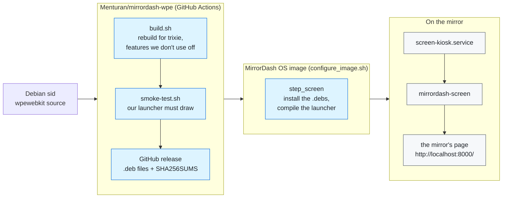

# The mirror's screen: WPE WebKit and `mirrordash-screen`

The mirror's page (`mirrordash_core/static/index.html`) is a normal web page. Something has to show it
full screen on the Raspberry Pi. That is two parts:

- **WPE WebKit**: the browser engine (the same engine as Safari, made for devices without a desktop).
  We build it ourselves in [Menturan/mirrordash-wpe](https://github.com/Menturan/mirrordash-wpe),
  because the version in Debian trixie gets no security fixes.
- **`mirrordash-screen`**: our own small program in C (`mirrordash-screen.c`, about 80 lines). It opens
  one full-screen window with the page in it, and nothing else: no address bar, no tabs, no way to
  leave the page.

Why it is built this way, and what was measured: ARCHITECTURE #56.

## From Debian to the screen

1. Every Monday, `check.yml` in mirrordash-wpe looks for a new `wpewebkit` in Debian sid. When there
   is one, `build.yml` builds it for trixie (about 2.5 hours the first time, minutes when the compiler
   cache has it).
2. Before anything is released, `smoke-test.sh` compiles our launcher against the new packages and runs
   it for 30 seconds. It must draw frames and not crash. If it fails, nothing is released and mirrors
   keep the last working WPE.
3. When an OS image is built, `step_screen` in `scripts/configure_image.sh` downloads the newest
   release, checks it against `SHA256SUMS`, installs it, compiles `mirrordash-screen.c` and removes the
   compiler again.

## What happens on the mirror

1. labwc (the Wayland compositor: the program that owns the screen) starts. Then systemd starts
   `screen-kiosk.service`, which runs `/usr/local/bin/mirrordash-screen`.
2. If the screen is turned off, the launcher waits until it is on. A view created without a screen
   never shows anything, even after the screen comes on (a WPE bug).
3. It shows `loading.html` until the server answers, then the mirror's page.
4. If the page's renderer crashes (for example out of graphics memory), the launcher exits with an
   error. systemd starts it again after 2 seconds. Only a new process gets the memory back.
5. A module's script can't send the screen anywhere else: every link or redirect away from
   `http://localhost:8000/` is blocked, and new windows never open.

The page's console messages, errors included, go to the journal: `journalctl -u screen-kiosk -f`.

## The files

| File | What it does |
| :--- | :--- |
| `scripts/screen/mirrordash-screen.c` | The launcher |
| `scripts/image/rootfs/etc/systemd/system/screen-kiosk.service` | Starts it, restarts it, keeps it off the home network (ARCHITECTURE #41) |
| `mirrordash_core/static/loading.html` | The page shown until the server answers |
| `step_screen` in `scripts/configure_image.sh` | Installs WPE and compiles the launcher into the image |
| `scripts/build_image.sh` | Stops an image without the launcher or with another WPE than ours |
| `tests/test_configure_image.py` | Checks the launcher's source and the unit for what must stay (the crash exit, the navigation guard) |
| mirrordash-wpe: `build.sh`, `smoke-test.sh`, `.github/workflows/` | Builds, tests and releases WPE |

## Changing the launcher

The launcher uses two libraries: WPE WebKit's API (`webkit_*`, `wpe_*`) and GLib (`g_*`), which WPE is
built on. Three GLib ideas are enough to read it:

- **The main loop** (`g_main_loop_run`) waits for events and calls your functions. The program runs
  inside it until something calls `g_main_loop_quit`.
- **Signals** (`g_signal_connect`) are callbacks: "when the view sends `close`, call `view_closed`".
- **`g_autofree`** frees a pointer by itself when it goes out of scope.

WPE only exists for arm64 here, so the launcher can't run on a normal PC. To try a change:

1. Push it to a branch of MirrorDash.
2. Run the smoke test with your branch's launcher against the newest WPE release:
   `gh workflow run smoke.yml -R Menturan/mirrordash-wpe -f tag=<newest release tag> -f mirrordash_ref=<your branch>`
   (the tag is on the [releases page](https://github.com/Menturan/mirrordash-wpe/releases)). It shows
   that it compiles with the image's flags (warnings are errors), runs and draws.
3. `uv run pytest tests/test_configure_image.py` checks that what must stay is still there.
4. The real check is on a Pi: a test OS image (`python3 scripts/release.py`, option 3, see RELEASING.md).
   Things only a Pi shows: the GPU, the screen turned off and on, memory.

## When the WPE build fails

The build fails loudly on purpose, instead of shipping something half-broken. Mirrors keep the last
release in the meantime, but they get no new security fixes until it is fixed. The run's log says which
check stopped it:

| The log says | What happened | What to do |
| :--- | :--- | :--- |
| `Debian's rules changed: look at the line again` | Debian changed a line in `debian/rules` that `build.sh` edits | Look at the new line in sid's `debian/rules` and change the `sed` in `build.sh` to match |
| `WebKit no longer knows: ...` | WebKit renamed or removed a build option we turn off | Find the new name in WebKit's `Source/cmake/OptionsWPE.cmake` |
| `dpkg-gensymbols: error: some symbols or patterns disappeared` | A function is gone from the library that Debian's symbol list expects | If it belongs to a feature we turn off: add it to the `sed` on the `.symbols` file in `build.sh`. If not: something is really missing, find out why |
| `apt-get build-dep` fails | sid's package needs a newer library than trixie has | The hardest case: see if a backport exists, or wait for Debian |
| `The launcher didn't run on these packages` | The smoke test failed: the new WPE breaks our launcher | Read the launcher's output in the log; fix the launcher (or report the bug to WebKit) |

After a fix, start the build again: `gh workflow run build.yml -R Menturan/mirrordash-wpe -f version=<Debian version>`.
When the build itself changes (not only Debian's version), raise `MIRRORDASH_BUILD` in `build.yml`, so
the new packages get a new version and tag.

## Words

| Word | Meaning |
| :--- | :--- |
| WPE WebKit | WebKit for devices: a browser engine without any browser window around it |
| WPEPlatform | WPE's own way to draw on a screen (here through labwc). Replaces the older libwpe |
| Cog | The launcher we used before. Built on libwpe, which WPE 2.54 deprecated |
| Web process | WebKit runs each page in a separate process. If it crashes, the launcher still runs |
| Origin | Where a page comes from: here `http://localhost:8000/`. Changing it starts a new web process |
| Wayland, labwc | Wayland is how programs draw on a Linux screen; labwc is the program (compositor) that owns the screen |
| Debian sid | Debian's development version, where new packages arrive first. trixie is the stable version the mirror runs |
| CMA | The memory the Raspberry Pi's GPU uses. When it runs out, the web process crashes (ARCHITECTURE #15) |
